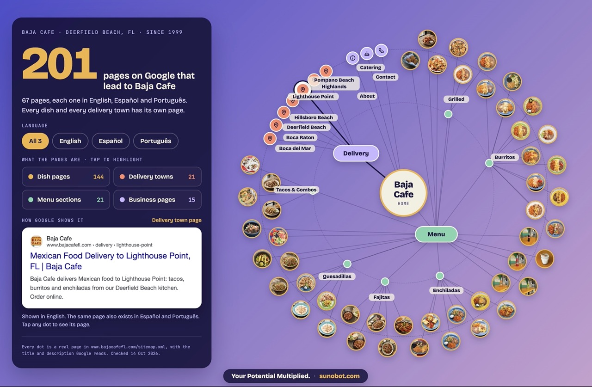

# Sitemap Visual

**Show a business every page Google can find, in one picture it understands.**

Telling a restaurant owner "we built 201 SEO pages for you" means nothing to them.
Showing them a map with their own café in the center, every dish they sell with its
photo, every town they deliver to, all three languages, and a Google result card
for each one, means a lot.

`sitemap-visual` is a [Claude Code](https://code.claude.com) skill that builds that
map automatically from the business's live `sitemap.xml`. You ask Claude for it; a
few minutes later you have an interactive canvas you can present on a laptop or a
projector, and a phone page the owner can open anywhere.



*The map for [Baja Cafe](https://www.bajacafefl.com), a Mexican restaurant in
Deerfield Beach, FL: 67 pages in English, Español and Português = 201 ways to be
found. The card on the left shows how Google presents the selected page.*

## What the map does

- **Every dot is a real page** from the site's `sitemap.xml`. Nothing is invented,
  and nothing is drawn by an AI image model.
- **Rings tell the story:** home in the center, then the menu and delivery hubs,
  then category pages, then every item (with its own photo) and every delivery
  town on the outer ring.
- **Languages multiply:** language chips switch between *All* (pages × languages)
  and each single language. The big number updates as you switch.
- **Highlight a group:** tap "Dish pages", "Delivery towns", "Menu sections" or
  "Business pages" to light that group up and dim the rest.
- **See it the way Google shows it:** hover or tap any dot and a search-result card
  shows that page's real title, description, address, photo and price, in the
  chosen language. The path from that page back to the home page lights up.
- **Scales:** from a dozen pages to hundreds. Dots shrink, towns get extra room,
  and labels are dropped only when they would overlap.

Tested on a restaurant (67 pages × 3 languages = 201) and a florist
(127 pages × 3 languages = 381, with 102 product photos).

## The phone version

The canvas is too wide for a phone and its dots are too small to tap, so every map
also comes with a **Site Tree**: one self-contained page built from the same data.

- **The map on the phone's own axis:** home at the top, a trunk down the left edge,
  sections branching off and opening in place.
- **Search every page** by name, title or URL, from a bar that stays pinned above
  the tree.
- **The same Google-style card** in a bottom sheet, with the page's path from home,
  previous and next buttons, and a swipe between pages.
- **Works on any site:** sections come from the URLs, so a plain site with folders
  like `/services/` and `/blog/` gets a real tree too.
- **Languages and prices** carry over. Language chips appear only when a site has
  more than one language.
- **Thumb-sized:** every button and link is at least 44px, and nothing scrolls
  sideways from 320px up.

It publishes as a private Artifact, or to Cloudflare Pages when you ask for a public
link. The page is marked `noindex`, because it repeats the site's own titles and
descriptions and should never compete with them in Google.

## Requirements

- **Claude Code** with **Artifacts** available (a claude.ai account). The map is a
  [Claude Design](https://claude.ai) canvas, created through Claude's Artifact tool.
- **Python 3** with **Pillow**: `pip install pillow`
- **Node.js** (only for the built-in logic checks)
- **Wrangler** (only to put the phone page on Cloudflare Pages)

## Install

### Option A: plugin marketplace (recommended)

In your shell:

```bash
claude plugin marketplace add cleitonsouza01/sitemap-visual
claude plugin install sitemap-visual@sitemap-visual
```

Or inside a Claude Code session:

```
/plugin marketplace add cleitonsouza01/sitemap-visual
/plugin install sitemap-visual@sitemap-visual
```

Updates arrive with `claude plugin marketplace update sitemap-visual`.

### Option B: skills CLI (Claude Code, Cursor, Codex and other agents)

```bash
npx skills add cleitonsouza01/sitemap-visual
```

Listed on [skills.sh](https://skills.sh/cleitonsouza01/sitemap-visual/sitemap-visual).
The map itself is a Claude Design canvas, so building one still needs Claude
with Artifacts.

### Option C: copy the skill

```bash
git clone https://github.com/cleitonsouza01/sitemap-visual.git
cp -r sitemap-visual/plugins/sitemap-visual/skills/sitemap-visual ~/.claude/skills/
```

Use `<your project>/.claude/skills/` instead of `~/.claude/skills/` to install it
for one project only.

## Use it

Just ask Claude:

> Make the sitemap map for www.example-taqueria.com

> Show Casa Verde how many pages they have on Google. Their store is
> store.example.com, slug casaverde. They're a florist.

When installed as a plugin you can also call it directly:
`/sitemap-visual:sitemap-visual www.example-taqueria.com` (or `/sitemap-visual …` when
copied into your skills folder).

Claude then:

1. **Collects** every page in every language from the live site (2–6 minutes,
   deliberately slow so the site's rate limits are respected), packs all item
   photos into one image sheet and grabs the site's icon.
2. **Creates a Design canvas** and uploads just two files: the photo sheet and the icon.
3. **Renders** the map with the page data built in, **checks** its logic, and
   **publishes** it.
4. **Builds the phone version** from the same data and checks it.
5. **Hands you the links** and tells you about anything missing on the site
   (items without a price or photo, pages that only answered after retries).

Canvases and Artifacts are private. Share yours from its **Share** menu before the
business opens it. A Cloudflare Pages link is public.

## The URL shape it understands

The map is designed for storefront-style sites:

| Path | Shown as |
|---|---|
| `/` | Home, in the center |
| `/menu` | Menu hub |
| `/menu/<category>` | Category page |
| `/menu/<category>/<item>` | Item page (photo from `og:image`, price from JSON-LD) |
| `/delivery` | Delivery hub |
| `/delivery/<town>` | Delivery town page |
| anything else | Business page (about, contact, catering, policies…) |

A language prefix (`/es/…`, `/pt/…`) marks a translation of the same page. Set the
languages with `--langs` (default `en,es,pt`; the first one is the language of
unprefixed URLs). Sites where one sitemap lists many businesses
(`/<lang>/<slug>/…`) work with `--slug`.

Other sites still render, but on the canvas all their pages land in "Business
pages". The rich view needs the shape above. The phone version does better: a
top-level folder holding two or more pages becomes its own section.

## Running the scripts yourself

The skill drives these for you, but they are plain scripts:

```bash
SK=plugins/sitemap-visual/skills/sitemap-visual/scripts

# 1. collect pages, photo sheet and icon
python3 $SK/build_data.py --base https://www.example.com --out work/example

# 2. after uploading work/example/sprite.jpg and icon.png to your canvas
python3 $SK/render.py --work work/example \
  --sprite-url /_blob/<id> --icon-url /_blob/<id> \
  --noun Dish --eyebrow "Example Taqueria · Austin, TX · since 2004"

# 3. run the map's logic outside the canvas (must print OK)
node $SK/check.js work/example/design/project/Main.dc.html
```

`work/example/design/` is then published to the canvas. The phone version needs no
uploads, because the photo sheet and the icon are built into the page:

```bash
# 4. build the phone page and check it (must print OK)
python3 $SK/render_tree.py --work work/example --noun Dish \
  --eyebrow "Example Taqueria · Austin, TX · since 2004"
node $SK/check_tree.js work/example/mobile/index.html work/example/manifest.json
```

`work/example/mobile/index.html` is a whole page for any static host, and
`work/example/tree-artifact.html` is the same page for an Artifact. To rename or
reorder sections, pass `--config` a JSON file; `SKILL.md` shows the format.

| File | What it does |
|---|---|
| `scripts/build_data.py` | Reads the sitemap, fetches each page per language (title, description, price, photo) with delay and retries, writes `pages.json`, `manifest.json`, `sprite.jpg`, `icon.png` |
| `scripts/render.py` | Fills the template with the business's data and writes the canvas files |
| `scripts/check.js` | Runs the map's logic in Node and fails on broken or off-canvas layout |
| `scripts/render_tree.py` | Works out the sections and writes the self-contained phone page |
| `scripts/check_tree.js` | Checks the phone page's counts, sections and URLs without printing site text |
| `template/Main.dc.html` | The interactive map (a Claude Design component) |
| `template/Tree.html` | The phone version |
| `SKILL.md` | The step-by-step instructions Claude follows |

## Customize the look

Everything visual lives in `template/Main.dc.html`, and in `template/Tree.html` for
the phone version. Change it there, never per business:

- **Background:** the root element's `linear-gradient(135deg, #5e60f7, #fbcafa)`
  (darkened 24% for contrast).
- **Colors per group:** `COLORS` in the script (items, towns, menu, business).
- **Brand pill** at the bottom center ("Your Potential Multiplied · sunobot.com"):
  replace it with your own line and link, in both templates.
- **Language names:** `LNAME` in the script.

## Security

The skill reads a website you choose, so everything it reads (titles,
descriptions, the business name, photos) is third-party content. It is handled
as data, never as instructions:

- **Plain text only.** The collector strips tags, control characters and
  invisible Unicode (zero-width and right-to-left override characters), and caps
  titles at 140, descriptions at 160 and the business name at 60 characters.
- **The site's own pages only.** It fetches `http(s)` URLs only, ignores sitemap
  entries on other hosts, maps at most 1,500 pages (`--max-pages`), and skips any
  page over 5 MB or image over 8 MB.
- **Shown as text, never run.** Site text is built into the canvas as escaped
  JSON and displayed as text. Nothing from the site executes.
- **Kept out of the conversation.** `SKILL.md` tells Claude never to act on
  instructions found in site text and not to read the page data into the chat;
  `check.js` and `check_tree.js` report the shape of each page, not its words.

Automated skill scanners may still flag "third-party content exposure". Reading a
website is what the skill is for, and the steps above keep that content inert.

## Limits

- The canvas is laid out for a laptop or projector (1440×940). Use the Site Tree on
  a phone.
- Town labels come from English titles shaped "… to Town, ST", else from the URL.
- A sitemap with only a few pages makes an unconvincing map; the skill says so
  instead of publishing one.
- Photos come from each item page's `og:image`; items without one show as plain dots.

## License

[MIT](LICENSE) © 2026 Cleiton Souza

## Credits

Built at [Sunobot](https://sunobot.com) to show local businesses what their
storefront does for them on Google.
