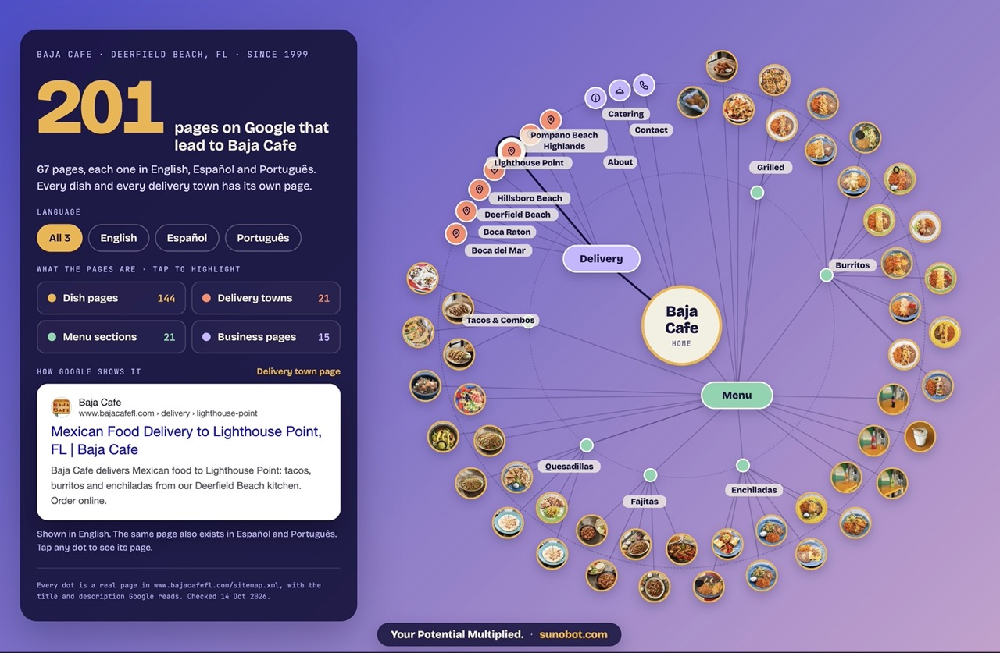

# Sitemap Visual

**Show a business every page Google can find, in one picture it understands.**

Telling a restaurant owner "we built 201 SEO pages for you" means nothing to them.
Showing them a map with their own café in the center, every dish they sell with its
photo, every town they deliver to, all three languages, and a Google result card
for each one, means a lot.

`sitemap-visual` is a [Claude Code](https://code.claude.com) skill that builds that
map automatically from the business's live `sitemap.xml`. You ask Claude for it; a
few minutes later you have an interactive canvas you can present on a laptop or a
projector.



*The map for [Baja Cafe](https://www.bajacafefl.com), a Mexican restaurant in
Deerfield Beach, FL: 67 pages in English, Español and Português = 201 ways to be
found. The card on the left shows how Google presents the selected page.*

## What the map does

- **Every dot is a real page** from the site's `sitemap.xml`. Nothing is invented,
  and nothing is drawn by an AI image model.
- **Rings tell the story:** home in the center, then the menu and delivery hubs,
  then category pages, then every item (with its own photo) and every delivery
  town on the outer ring.
- **Languages multiply:** language chips switch between *All* (pages × languages)
  and each single language. The big number updates as you switch.
- **Highlight a group:** tap "Dish pages", "Delivery towns", "Menu sections" or
  "Business pages" to light that group up and dim the rest.
- **See it the way Google shows it:** hover or tap any dot and a search-result card
  shows that page's real title, description, address, photo and price, in the
  chosen language. The path from that page back to the home page lights up.
- **Scales:** from a dozen pages to hundreds. Dots shrink, towns get extra room,
  and labels are dropped only when they would overlap.

Tested on a restaurant (67 pages × 3 languages = 201) and a florist
(127 pages × 3 languages = 381, with 102 product photos).

## Requirements

- **Claude Code** with **Artifacts** available (a claude.ai account). The map is a
  [Claude Design](https://claude.ai) canvas, created through Claude's Artifact tool.
- **Python 3** with **Pillow**: `pip install pillow`
- **Node.js** (only for the built-in logic check)

## Install

### Option A: plugin marketplace (recommended)

In your shell:

```bash
claude plugin marketplace add cleitonsouza01/sitemap-visual
claude plugin install sitemap-visual@sitemap-visual
```

Or inside a Claude Code session:

```
/plugin marketplace add cleitonsouza01/sitemap-visual
/plugin install sitemap-visual@sitemap-visual
```

Updates arrive with `claude plugin marketplace update sitemap-visual`.

### Option B: skills CLI (Claude Code, Cursor, Codex and other agents)

```bash
npx skills add cleitonsouza01/sitemap-visual
```

Listed on [skills.sh](https://skills.sh/cleitonsouza01/sitemap-visual/sitemap-visual).
The map itself is a Claude Design canvas, so building one still needs Claude
with Artifacts.

### Option C: copy the skill

```bash
git clone https://github.com/cleitonsouza01/sitemap-visual.git
cp -r sitemap-visual/plugins/sitemap-visual/skills/sitemap-visual ~/.claude/skills/
```

Use `<your project>/.claude/skills/` instead of `~/.claude/skills/` to install it
for one project only.

## Use it

Just ask Claude:

> Make the sitemap map for www.example-taqueria.com

> Show Casa Verde how many pages they have on Google. Their store is
> store.example.com, slug casaverde. They're a florist.

When installed as a plugin you can also call it directly:
`/sitemap-visual:sitemap-visual www.example-taqueria.com` (or `/sitemap-visual …` when
copied into your skills folder).

Claude then:

1. **Collects** every page in every language from the live site (2–6 minutes,
   deliberately slow so the site's rate limits are respected), packs all item
   photos into one image sheet and grabs the site's icon.
2. **Creates a Design canvas** and uploads just two files: the photo sheet and the icon.
3. **Renders** the map with the page data built in, **checks** its logic, and
   **publishes** it.
4. **Hands you the link** and tells you about anything missing on the site
   (items without a price or photo, pages that only answered after retries).

Canvases are private. Share yours from the canvas's **Share** menu before the
business opens it.

## The URL shape it understands

The map is designed for storefront-style sites:

| Path | Shown as |
|---|---|
| `/` | Home, in the center |
| `/menu` | Menu hub |
| `/menu/<category>` | Category page |
| `/menu/<category>/<item>` | Item page (photo from `og:image`, price from JSON-LD) |
| `/delivery` | Delivery hub |
| `/delivery/<town>` | Delivery town page |
| anything else | Business page (about, contact, catering, policies…) |

A language prefix (`/es/…`, `/pt/…`) marks a translation of the same page. Set the
languages with `--langs` (default `en,es,pt`; the first one is the language of
unprefixed URLs). Sites where one sitemap lists many businesses
(`/<lang>/<slug>/…`) work with `--slug`.

Other sites still render, but all their pages land in "Business pages". The rich
view needs the shape above.

## Running the scripts yourself

The skill drives these for you, but they are plain scripts:

```bash
SK=plugins/sitemap-visual/skills/sitemap-visual/scripts

# 1. collect pages, photo sheet and icon
python3 $SK/build_data.py --base https://www.example.com --out work/example

# 2. after uploading work/example/sprite.jpg and icon.png to your canvas
python3 $SK/render.py --work work/example \
  --sprite-url /_blob/<id> --icon-url /_blob/<id> \
  --noun Dish --eyebrow "Example Taqueria · Austin, TX · since 2004"

# 3. run the map's logic outside the canvas (must print OK)
node $SK/check.js work/example/design/project/Main.dc.html
```

`work/example/design/` is then published to the canvas.

| File | What it does |
|---|---|
| `scripts/build_data.py` | Reads the sitemap, fetches each page per language (title, description, price, photo) with delay and retries, writes `pages.json`, `manifest.json`, `sprite.jpg`, `icon.png` |
| `scripts/render.py` | Fills the template with the business's data and writes the canvas files |
| `scripts/check.js` | Runs the map's logic in Node and fails on broken or off-canvas layout |
| `template/Main.dc.html` | The interactive map (a Claude Design component) |
| `SKILL.md` | The step-by-step instructions Claude follows |

## Customize the look

Everything visual lives in `template/Main.dc.html`. Change it there, never per
business:

- **Background:** the root element's `linear-gradient(135deg, #5e60f7, #fbcafa)`
  (darkened 24% for contrast).
- **Colors per group:** `COLORS` in the script (items, towns, menu, business).
- **Brand pill** at the bottom center ("Your Potential Multiplied · sunobot.com"):
  replace it with your own line and link.
- **Language names:** `LNAME` in the script.

## Limits

- Laid out for a laptop or projector (1440×940), not a phone.
- Town labels come from English titles shaped "… to Town, ST", else from the URL.
- A sitemap with only a few pages makes an unconvincing map; the skill says so
  instead of publishing one.
- Photos come from each item page's `og:image`; items without one show as plain dots.

## License

[MIT](LICENSE) © 2026 Cleiton Souza

## Credits

Built at [Sunobot](https://sunobot.com) to show local businesses what their
storefront does for them on Google.
